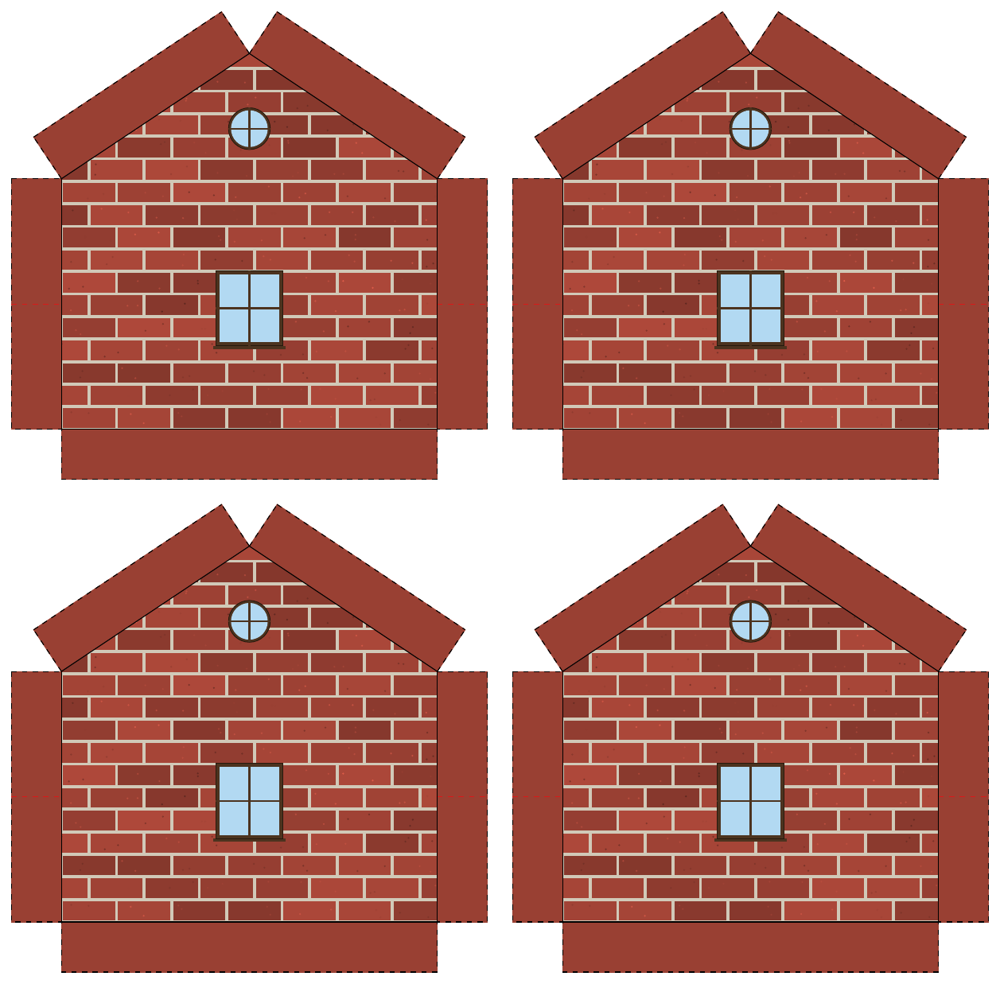
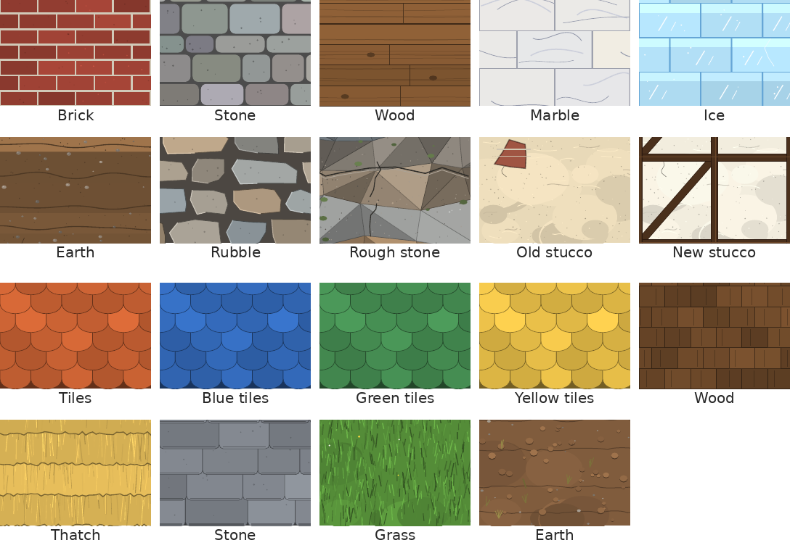
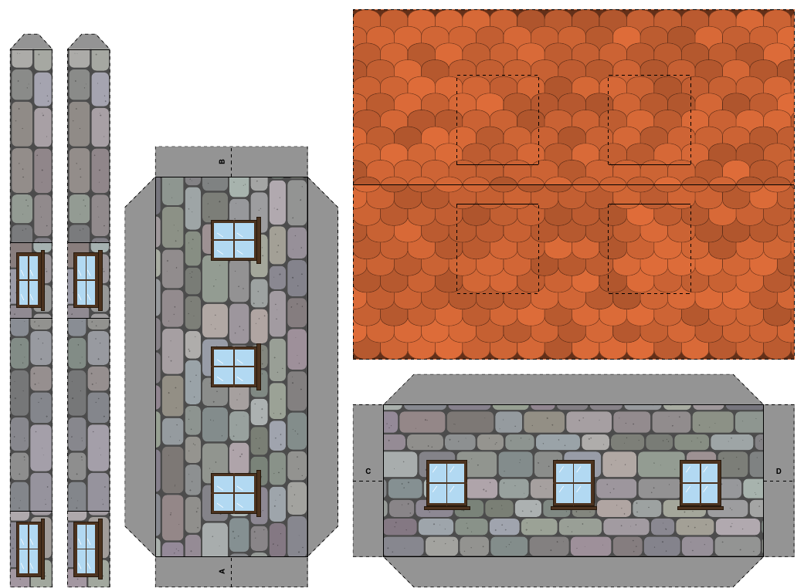
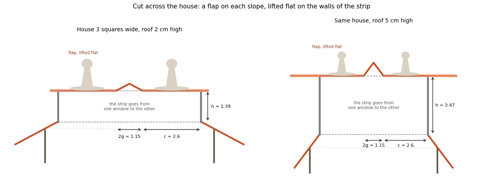
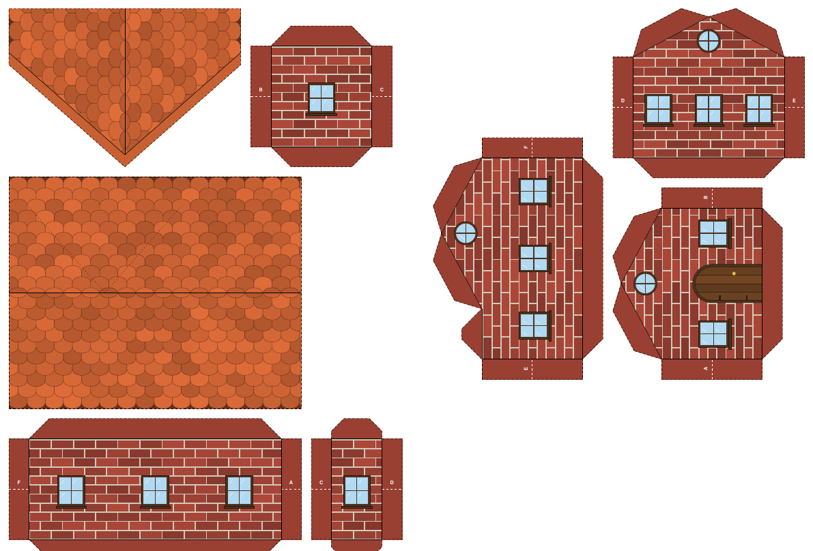
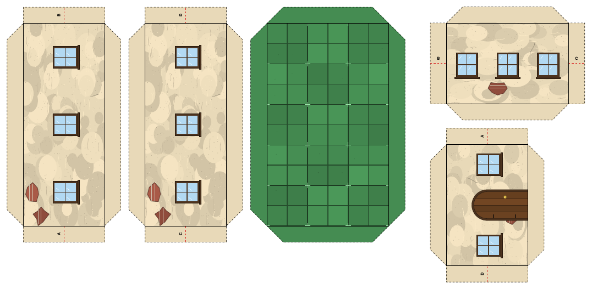
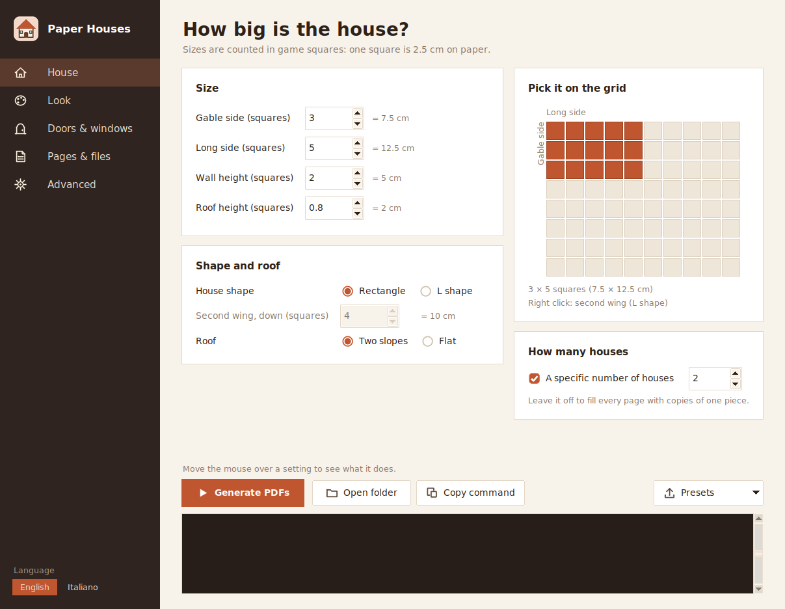

# Paper Houses

Procedural, printable paper houses for tabletop RPGs (built for D&D 5e).

A Python script draws the cutting and folding templates for a small house, **sized on the 2.5 cm battle-map grid**, and paints them with procedurally generated textures, complete with a door and windows. The house can be a rectangle or an L, with a gabled or a flat roof, and the roof can have flat windows where miniatures can stand. Everything is drawn as vector graphics straight into the PDF, so it stays sharp at any print size and needs nothing but `reportlab`.



## Features

- **Grid-accurate**: wall sizes are the *inner* rectangle, measured in 2.5 cm game squares. The 1 cm tabs are added outside and never count towards the house size.
- **Procedural textures**, the same every time for a given `seed`, only inside the solid lines (the tabs have the base colour, which makes cutting and gluing easier):
  - 10 walls: brick, stone, wood, marble, ice, earth, rubble (rough stones in mortar), rough stone (a rock face), old stucco (with bricks showing here and there) and new stucco (white, in a wooden frame, like the houses of the Middle Ages)
  - 9 roofs: tiles (red, blue, green, yellow), wood shingles, thatch, stone slabs, grass, earth
- **Door and windows in several styles**, chosen on the Look page with a picture of each: windows can be classic, stone, castle slits (no glass) or stained glass; the door can be plain wood, with iron bands, or a studded gate. Door and windows can be turned off separately.
- **The door can be in the centre, on the left or on the right** of its wall, and on the short or the long side of the house.
- **Rectangular or L-shaped houses**, with a **gabled or a flat roof**. A flat roof is paved with tiles that mark the 2.5 cm squares, so miniatures can stand on it.
- **Roof windows**: flat spots halfway down each slope of the roof, supported by a strip of paper, where miniatures can stand.
- **A window to set everything**: run `python main.py` and a window opens, with a page for each group of settings, presets and a button that copies the equivalent command. English and Italian.
- **Nothing to install**: run it from the Actions tab of the GitHub repository, fill a form and download the PDFs.
- **Flexible page packing** on A4 or US Letter: by default every page is filled with copies of one piece (rotated when it helps); with `--houses N` you get exactly the pieces for N houses, and with `--mix-pieces` different pieces share the pages.
- **One door per house**: the door is assigned house by house, so N houses get N doors; the other wall of the pair gets ordinary windows.
- **Corner letters** on the side tabs: the two tabs with the same letter are glued together (`A` to `D` on a rectangle, `A` to `F` on an L, with the house number when you print several houses).
- **Tabs that never overlap**: the tabs at the top and at the bottom of the walls, the flaps of the gables and the tabs of a flat roof are trapezoids, and you can leave out the top or the bottom ones.
- **Calibration ruler**: a 5 cm line on every page, to check the scale of the print.
- **Checks**: warnings for sizes that are not multiples of 2.5 cm, clear messages for wrong settings, and a hint when a PDF is locked by a viewer.

## Gallery

Top: brick, stone, wood, marble, ice, earth, rubble, rough stone, old stucco and new stucco walls. Bottom: red, blue, green and yellow tiles, wood, thatch, stone, grass and earth roofs.



## How to read the sheets

| Line | Meaning |
| --- | --- |
| Solid black | **Fold** |
| Dashed black | **Cut** |
| Dashed mark half-way up each side tab | Marks where to cut for the interlocking joint |
| Letter on a side tab | The two tabs with the same letter go together |

With textures off (the default) you get just the line templates.

## Roof windows

Turn on **Roof windows** (page *Doors & windows*, or `--roof-windows`) to get flat spots on the roof where miniatures can stand. They work on a rectangular house with a gabled roof, at least 3 squares long.



On each slope, halfway between the ridge and the eaves, a flap is cut on three sides (dashed) and folds along the fourth, the one towards the ridge (solid). The flap is lifted until it lies flat, on top of a **strip of paper folded into a rectangle**: the strip is the wall under the flap and its support. It goes from the window on one slope to the window on the other, under the part of the roof near the ridge that is left whole. The two sides of the strip that face outside show a window.



The first and the last square of the house stay free; in between the windows take every other square, always symmetric: 3 squares give one window in the middle, 4 give two joined in the middle, 5 give two with an empty square between them.

The measures are computed. With `c` one square plus a little room (`roof_window_clearance_cm`, 2.6 cm) and `g` the distance of the fold from the ridge (halfway by default, change it with `roof_window_position` from `0` at the ridge to `1` at the eaves), the cut is as deep along the slope as the hypotenuse `c / cos(roof angle)`, the strip is `sqrt(hypotenuse² - c²)` high and `2 · (g + c)` long, and as wide as the window.

**Assembly.** Cut the three dashed sides of every flap (not the fold). Fold each strip into a rectangle and glue the tab. Before putting the roof on the walls, slip every strip under the roof, with its two window faces at the lower edge of the two flaps, then lift the flaps flat and glue them on the top edge of the strip. A flap is a little longer than the strip is wide, so it sticks out slightly.

## L-shaped houses

Choose **L shape** on the page *House*, or **right-click on the grid** as far down as the second wing should go. On the command line: `--house-shape L`. The house is made of two wings of the same width: the first is `length_cm` long, the second one `wing_length_cm` (the length of the outside wall, so both include the corner square), and both must be at least one square longer than the width of the house.



There are **six walls**, numbered around the house, with the corner letters `A` to `F`. Wall 1 is the long outside wall of the first wing, wall 2 its gable (with the door when `door_on` is `short`), walls 3 and 4 are inside, wall 5 is the gable of the second wing and wall 6 its long outside wall, which has a gable too, but only at the end next to the first wing.

The gabled roof is made of **two roofs, and each one rests on two supports**. **Roof A** is a long roof over the whole first wing: it rests on the gable of wall 2 and on the one at the end of wall 6. Two thin dotted lines on one of its slopes show where roof B is glued. **Roof B** covers the second wing: it rests on the gable of wall 5 and, at the other end, on roof A: the end of each slope is cut at an angle, along the valley where the two roofs meet, and has a tab to glue under roof A. Glue roof A first, then roof B along the dotted lines.

## Flat roofs

Choose **Flat** as the roof (`--roof-type flat`). The short walls lose their gable and the roof is one sheet shaped like the house, paved with tiles: two tiles to a side of a game square, a thicker joint along every square, a small cross at every corner and squares a little lighter and darker, like a chess board. It has a **tab along every side**, a trapezoid like the tabs of the walls (`roof_margin_cm` is their depth), so there is no border at the outside corners.



## Tabs

- **Corners** (`tab_corners`): by default the whole corner of the tabs at the top and at the bottom of the walls, of the flaps along the gables and of the flat roof is cut at 45 degrees, so they are trapezoids and never overlap a neighbour. With `--tab-corners square` they keep square corners and only the ones that would overlap are cut.
- **Top and bottom tabs** can be left out separately (`--no-top-tabs`, `--no-bottom-tabs`). The side tabs are always printed.

## Scale

| Value | Meaning |
| --- | --- |
| 2.5 cm | one game square, 1.5 m in the fiction |
| 5 cm wall height (default) | 3 m, one storey |
| 7.5 x 12.5 cm footprint (default) | 3 x 5 squares |

Doors are 1 m to 1.5 m wide depending on the wall length, windows are 0.8 x 0.9 m, with one floor of windows for every 5 cm of wall height. With the door on the left (or right) it is a quarter of the wall from the edge: on a wall 6 squares wide, around the second (or the fifth) square, and the windows fill what is left on each side.

## Run it on GitHub (nothing to install)

1. Open the **Actions** tab of the repository.
2. Pick **Generate paper houses** in the left sidebar.
3. Press **Run workflow**, fill the form and confirm.
4. After about a minute the run turns green. Open it and download the `paper-houses-N` file at the bottom: a zip with the PDFs. The run page also lists what is on every page.

The form has the number of houses, the shape and the roof, the roof windows, the materials ("every combination" makes all 90 versions), the look of the windows, which tabs to print, what to draw on the walls (door and windows, only the door, only the windows or neither), the paper size, the sizes in cm and the texture seed. Any other option can be typed in the last field, for example `--door-position left --door-style studded` (run `python main.py --help` to see them all). GitHub allows at most 25 fields in a form, and this one uses all of them.

You need a GitHub account. On the original repository only people with write access can run workflows; everybody else can **fork** it (one click), enable Actions in the fork and run it there. The PDFs stay attached to the run for 30 days. The workflow is `.github/workflows/generate.yml`.

## Requirements

- Python 3.10+
- [ReportLab](https://pypi.org/project/reportlab/), and Pillow for the pictures of the window
- tkinter, only for the window. It comes with Python on Windows and macOS. On Linux: `sudo apt install python3-tk`.

```bash
pip install -r requirements.txt
```

## Usage

### The window

```bash
python main.py
```

Started with no options, the program opens a window:



- One page for each group of settings: **House** (sizes, shape and roof), **Look** (materials, the look of windows and door, lines), **Doors & windows**, **Pages & files** and **Advanced**, which holds every other setting. Move the mouse over a setting to read what it does.
- On the page **House** you pick the size on the grid: **left click** sets the sides of the house, **right click** sets the second wing of an L, as far down as you click; it is drawn in a lighter colour. A right click on the house itself takes the second wing away.
- Settings that do nothing in the current situation are greyed out: the second wing when the house is not an L, the pitch of the roof when the roof is flat, the window settings when the windows are off.
- **Presets** keeps a set of settings in a small `.json` file. **Copy command** puts the equivalent command-line command in the clipboard, which is also a quick way to fill the form of the GitHub workflow.
- The language, English or Italian, is chosen at the bottom left.

The window needs a screen. On a server, or if tkinter is missing, the program says so and suggests the command line.

### The command line

Every setting can also be given as an option, and then no window opens:

```bash
# Two textured houses with a flat roof of green tiles, pieces mixed on US Letter pages
python main.py --textures-enabled --wall-material stucco --roof-material green_tiles \
               --roof-type flat --houses 2 --mix-pieces --paper Letter

# A house with roof windows, stained glass windows and a studded gate on the left
python main.py --textures-enabled --houses 1 --mix-pieces --roof-windows \
               --length-cm 12.5 --roof-height-cm 2 --window-style stained \
               --door-style studded --door-position left

# An L-shaped house in marble, without the tabs at the bottom
python main.py --textures-enabled --wall-material marble --houses 1 --mix-pieces \
               --house-shape L --no-bottom-tabs

# Only windows, no door
python main.py --no-door

# Generate with the defaults of the file, without opening the window
python main.py --no-gui

# All the options
python main.py --help
```

The defaults live in the `Config` class at the top of `main.py`; the options and the window start from them.

### What you get

By default only the combined PDF is written, in an `output/` folder next to the script (`--no-complete-only` writes a PDF for every piece too):

| File | Content |
| --- | --- |
| `house_DnD_complete.pdf` | The pieces on A4 or Letter pages |
| `house_DnD_short_wall.pdf`, `..._long_wall.pdf`, `..._roof.pdf` | With `--no-complete-only`: one PDF for each piece |
| `house_DnD_roof_strip_N.pdf` | The strip of the roof windows N squares wide |
| `house_DnD_wall_N.pdf`, `..._roof_wing_A.pdf` | With an L: the six walls and the roofs |

A rectangular house needs **2 short walls, 2 long walls and 1 roof** (plus a strip for every roof window), an L its **6 walls and 1 or 2 roofs**. Without `--houses` each page is filled with copies of one piece; with `--houses N` you get exactly what N houses require. If a PDF cannot be written (`PermissionError` on Windows), it is almost always still open in a PDF viewer: close it and run again.

## Configuration

Each setting has an option with the same name and dashes (`wall_material` is `--wall-material`); on/off settings accept `--name` and `--no-name`. Defaults are in `Config`; in the window every setting is also in the *Advanced* page.

| Setting | Default | What it does |
| --- | --- | --- |
| `generate_full_house` | `True` | Whole house or a single wall PDF |
| `width_cm`, `length_cm`, `height_cm` | `7.5`, `12.5`, `7.5` | Inner sizes of the walls (the first wing of an L) |
| `house_shape` | `"rectangle"` | `"rectangle"` or `"L"` |
| `wing_length_cm` | `10.0` | L only: length of the second wing, at least one square more than the width |
| `roof_type` | `"gabled"` | `"gabled"` or `"flat"` |
| `roof_height_cm`, `roof_flap_cm`, `roof_overhang_cm`, `roof_margin_cm` | `5.0`, `1.0`, `0.5`, `1.0` | Gable height, flaps, overhang, margin (the depth of the tabs of a flat roof) |
| `top_tabs`, `bottom_tabs` | `True` | Print the tabs at the top / at the bottom of the walls |
| `tab_corners` | `"cut"` | `"cut"`: trapezoid tabs; `"square"`: cut only where they would overlap |
| `tab_width_cm` | `1.0` | Tab width |
| `textures_enabled` | `False` | Textures on or off |
| `wall_material` | `"wood"` | `brick`, `stone`, `wood`, `marble`, `ice`, `earth`, `rubble`, `fieldstone`, `old_stucco`, `new_stucco` |
| `roof_material` | `"thatch"` | `tiles`, `blue_tiles`, `green_tiles`, `yellow_tiles`, `wood`, `thatch`, `stone`, `grass`, `earth` |
| `generate_all_variants` | `False` | Generate all 90 material combinations |
| `seed` | `7` | Another seed, another variation of the textures |
| `door`, `windows` | `True` | Draw the door / the windows |
| `door_on` | `"short"` | Door on the `"short"` or the `"long"` side |
| `door_position` | `"center"` | `"center"`, `"left"` or `"right"` of its wall, seen from outside |
| `door_style` | `"wood"` | `"wood"`, `"iron"` (iron bands) or `"studded"` |
| `window_style` | `"classic"` | `"classic"`, `"stone"`, `"castle"` (slits, no glass) or `"stained"` |
| `floor_height_cm`, `window_spacing_cells` | `5.0`, `2.0` | One floor of windows every so many cm; distance between windows in squares |
| `roof_windows` | `False` | Flat windows on the roof |
| `roof_window_position`, `roof_window_clearance_cm` | `0.5`, `0.1` | Where the windows sit on the slope; room around them |
| `one_door_per_house` | `True` | Only one wall per house gets the door |
| `paper` | `"A4"` | `"A4"` or `"Letter"` |
| `houses`, `mix_pieces` | none, `False` | Exactly the pieces for N houses; pieces of different kinds share the pages |
| `joint_labels`, `calibration_ruler`, `allow_rotation` | `True` | Corner letters, 5 cm ruler, rotate pieces by 90 degrees |
| `complete_only` | `True` | Write only the combined PDF |
| `output_dir`, `base_name` | `"output"`, `"house_DnD"` | Where and how the PDFs are named |
| `language` | `"en"` | `"en"` or `"it"`: language of the messages |

Colours and dash pattern can only be changed in the file. Door and window sizes are set in metres of the fiction (`door_width_min_m`, `door_width_max_m`, `door_height_m`, `window_width_m`, `window_height_m`, `window_sill_m`, `round_window_radius_m`) and converted with `cell_cm` and `meters_per_cell`.

**Adding a material.** Write a texture function in `textures.py` and register it with `@wall_texture("name", base=(r, g, b))` or `@roof_texture(...)`. It shows up in the options and in the window by itself; add its name as `material.<name>` in `i18n.py` and a picture in `draw_swatch` in `gui_images.py`. A wall can also draw its own details over the texture, like the wooden frame of the new stucco. Do not use transparency in a texture: a texture that is drawn once and used again would lose it.

## Files

| File | Content |
| --- | --- |
| `main.py` | The settings (`Config`), the pieces, the page packing, the command line |
| `textures.py` | The wall and roof textures |
| `openings.py` | Where doors and windows go on a wall |
| `fittings.py` | Doors and windows as drawings, and their styles |
| `drawing.py` | Small helpers: colours, paths |
| `gui.py`, `gui_images.py` | The window, and its icons and pictures |
| `i18n.py` | The texts, in English and Italian |
| `test_*.py` | The tests |

## Printing and assembly

- Print at **100% / "actual size"**, never "fit to page". The ruler at the bottom of every page should measure exactly 5 cm.
- Cut along the dashed lines and fold along the solid ones. Thick paper or light card works best.
- For roof windows, build the strips and fit them under the roof before putting the roof on the walls.

## Tests

```bash
python -m unittest -v
```

The tests cover geometry, packing, doors and windows, roof windows, L-shaped houses, flat roofs, tabs, textures, validation, the command line, the generated PDFs, the texts in both languages and the window. The tests that open the window are skipped when there is no screen; on Linux you can give them a virtual one with `xvfb-run python -m unittest`.

## Known limitations

- The corner letters tell you which tabs go together, not which one is slit from the top and which from the bottom for the interlocking joint.
- The packer is a fast heuristic: it does not always find the layout with the fewest pages.
- Textures are procedural and not meant to look photographic.
- Roof windows work only on a rectangular house with a gabled roof.
- The two wings of an L have the same width, and its two roofs do not make the hip you would see on a real house at the outside corner.
- A flat roof is a plain sheet: no parapet.

## Roadmap

- Wings of different widths for L-shaped houses, and other shapes (T, U)
- Optional second storey for larger walls
- Preview of the pages inside the window