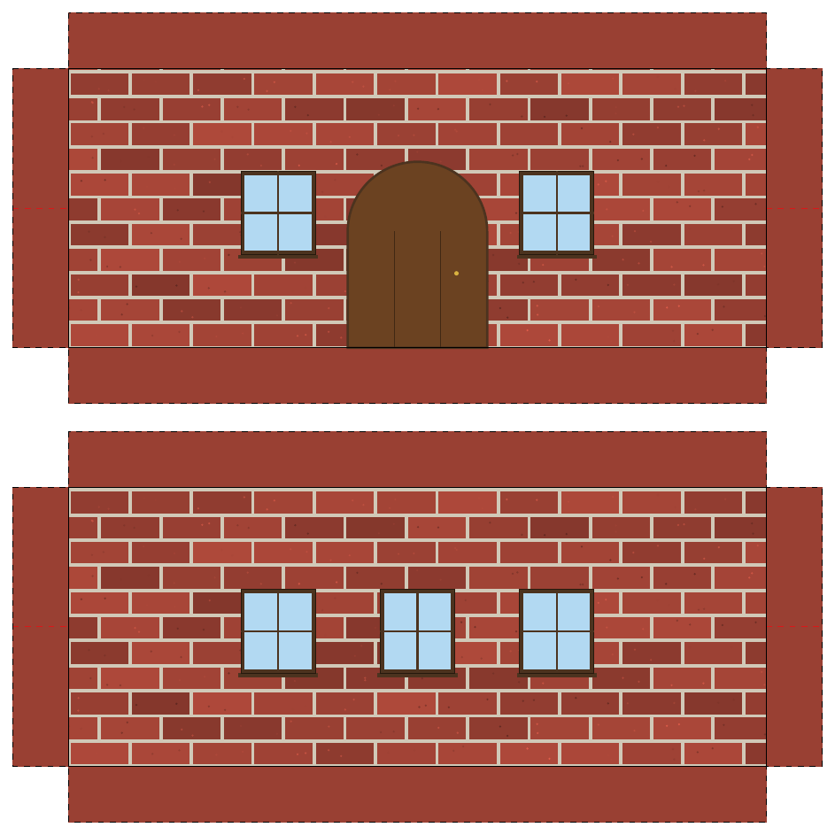
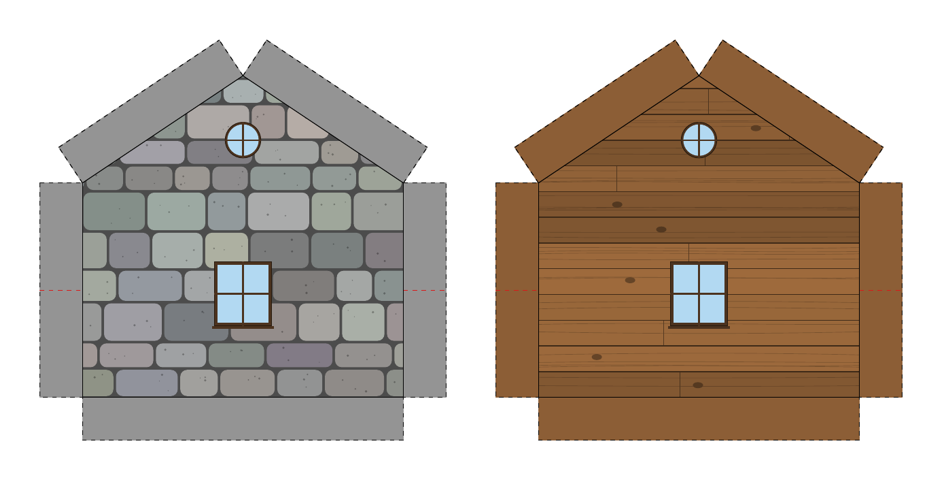
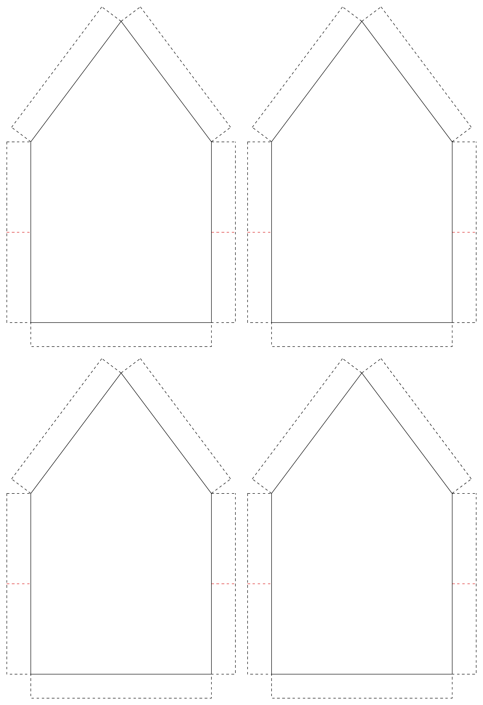

# Paper Houses

Procedural, printable paper houses for tabletop RPGs (built for D&D 5e).

A single Python script draws the cutting and folding templates for a small house, **sized on the 2.5 cm battle-map grid**, and paints them with procedurally generated textures (brick, stone, wood, marble or ice walls; tile, blue tile, wood, thatch or stone roofs), complete with a door and windows. The house can be a rectangle or an L, with a gabled or a flat roof, and the roof can have flat windows where miniatures can stand. Everything is drawn as vector graphics straight into the PDF, so it stays sharp at any print size and needs nothing but `reportlab`.


## Features

- **Grid-accurate**: wall sizes are the *inner* rectangle, measured in 2.5 cm game squares. The 1 cm tabs are added outside and never count towards the house size.
- **Procedural textures**, deterministic for a given `seed`:
  - Walls: brick, stone, wood (horizontal planks), marble (white blocks with grey veins), ice (blue blocks with highlights and cracks)
  - Roofs: clay tiles, blue tiles, wood shingles, thatch, stone slabs
  - Textures only cover the area inside the solid lines. Tabs get the flat base colour only, which makes cutting and gluing easier.
- **Rectangular or L-shaped houses**, with a **gabled or a flat roof**. A flat roof is paved with tiles that mark the 2.5 cm game squares, so miniatures can stand on it.
- **Roof windows**: flat spots halfway down each slope of the roof, supported by a strip of paper, where miniatures can stand (see below).
- **A window to set everything**: run `python main.py` and a window opens, with a page for each group of settings, a log, presets and a button that copies the equivalent command. It speaks English and Italian.
- **Nothing to install**: run it from the Actions tab of the GitHub repository, fill a form and download the PDFs (see below).
- **Door and windows scaled to the story world**: 2.5 cm = 1.5 m. Doors are 1 m to 1.5 m wide depending on the wall length, windows are 0.8 x 0.9 m. Arched plank door with frame, hinges and handle, framed windows with sills, round window in the gable. Windows are spread evenly along each wall, with one floor of windows for every 5 cm of wall height.
- **Door on the short or the long side**, your choice.
- **Whole-house mode**: the walls and the roof, as separate PDFs plus one combined PDF (by default only the combined one).
- **Flexible page packing** for the combined PDF, on A4 or US Letter:
  - By default every page is filled with as many copies of one piece as fit, rotating pieces by 90 degrees when it helps.
  - With `--houses N` you get exactly the pieces for N houses, and with `--mix-pieces` different pieces share the same pages to save paper.
- **One door per house**: the door is assigned house by house, so N houses get N doors. The other wall of the pair gets a window in its place.
- **Corner letters** on the side tabs: the two tabs with the same letter (A to D for a rectangle, A to F for an L, prefixed by the house number when you print several houses) are glued together.
- **Tabs you can leave out**: the tabs at the top and at the bottom of the walls only help the shape; you can print the walls without them.
- **Calibration ruler**: a 5 cm line on every page of the combined PDF, to check that the print is at the right scale.
- **Readable marks**: the half-height mark and the letters change to black or white when they would be hard to see on the wall colour.
- **Textures are drawn once per PDF** and reused for every copy, which roughly halves the size of a textured file with two houses.
- **Checks**: warnings for sizes that are not multiples of 2.5 cm, clear messages for wrong settings, and a hint when a PDF is locked by a viewer.
- Optional: generate all 25 wall/roof material combinations in one run.

## Gallery

Wall and roof materials (top: brick, stone, wood, marble, ice walls; bottom: tiles, blue tiles, wood, thatch, stone roofs):


The long wall carries the door. With the "one door per house" option, the second copy on the sheet gets a window instead:



The short wall (with the roof gable and its round window) in stone and in wood:



## How to read the sheets

| Line | Meaning |
| --- | --- |
| Solid black | **Fold** |
| Dashed black | **Cut** |
| Dashed mark half-way up each side tab (red, or white/black on dark or red walls) | Marks where to cut for the interlocking joint |
| Letter on a side tab (`A` to `D`, or `A` to `F` for an L, e.g. `2B` with several houses) | The two tabs with the same letter go together |

The corners between two side tabs are left blank: they are cut away and do not appear in the folded house. The dashed outline follows the resulting cross shape.

With textures disabled (the default) you get just the line templates:



## Roof windows

Turn on **Roof windows** (page *Doors & windows*, or `--roof-windows`) to get flat spots on the roof, where miniatures can stand. They work on a rectangular house with a gabled roof, at least 3 squares long.


**How it is built.** On each slope of the roof, halfway between the ridge and the eaves, a flap is cut on three sides (dashed) and folds along the fourth, the one towards the ridge (solid). The flap is lifted until it lies flat, on top of a **strip of paper folded into a rectangle**. The strip is the wall under the flap and its support. It goes from the window on one slope to the window on the other, under the part of the roof near the ridge that is left whole. The two sides of the strip that face outside show a window.


**Where the windows go.** The first and the last square of the house stay free; in between the windows take every other square, always symmetric:

| Squares along the house | Windows |
| --- | --- |
| 3 | one in the middle |
| 4 | two joined in the middle (one strip, 5 cm wide) |
| 5 | two, with an empty square between them |
| 6 | the second and the fifth square |
| 7 | the second, fourth and sixth square |

**The measures** (all computed, nothing to type):

- `c`: one square plus a little room (`roof_window_clearance_cm`, 1 mm), 2.6 cm by default. It is how far the window reaches from the fold, measured flat.
- `g`: how far the fold is from the ridge, measured flat. By default the window is halfway: `g = (half the width - c) / 2`. Change it with `roof_window_position`, from `0` (at the ridge) to `1` (at the eaves).
- The depth of the cut along the slope is the hypotenuse of a right triangle with the leg `c`, and the **height of the strip** is the other leg: `h = sqrt(hypotenuse² - c²)`.
- The strip is `2 · (g + c)` long across the roof and as wide as the window (2.5 cm, or 5 cm for two joined windows).

**Assembly.**

1. Cut the three dashed sides of every flap on the roof sheet. Do not cut the fold: the flap stays attached.
2. Fold each strip along the solid lines into a rectangle and glue the tab.
3. Before putting the roof on the walls, slip every strip under the roof so that its two window faces sit at the lower edge of the two flaps, one on each slope.
4. Lift the flaps flat and glue them on the top edge of the strip. A flap is a little longer than the strip is wide, so it sticks out slightly at the lower edge.

## L-shaped houses

Choose **L shape** (page *House*, or `--house-shape L`). The house is made of two wings with the same width:

- the first wing is `length_cm` long, the second one `wing_length_cm` (the length of the outside wall, so both include the corner square);
- both must be longer than the width of the house.


There are **six walls**, numbered around the house, with the corner letters `A` to `F`: wall 1 is the long outside wall of the first wing, wall 2 its gable (with the door when `door_on` is `short`), wall 3 and wall 4 are inside, wall 5 is the gable of the second wing and wall 6 its long outside wall.

The gabled roof is made of **two roofs, one for each wing**. Where the two wings meet, the roofs are cut at an angle: a hip on the outside corner and a valley on the inside corner. The first roof has two glue tabs on those slanted edges, to glue under the second roof. With a flat roof there is a single roof sheet shaped like an L.

## Flat roofs

Choose **Flat** as the roof (`--roof-type flat`). The short walls lose their gable, and the roof is a single sheet with a margin all around (`roof_margin_cm`), paved with tiles. There are two tiles to a side of a game square, a thicker joint along every square, a small cross at every corner and squares that are a little lighter and darker, like a chess board. The material of the roof gives the colour of the tiles.


## Walls without the top and bottom tabs

The tabs at the top and at the bottom of the walls help to keep the shape, but the house stands without them. Turn off **Top and bottom tabs** (page *Advanced*, or `--no-top-bottom-tabs`) to print the walls with the side tabs only. They are smaller, so more fit on a page.


## Scale

| Value | Meaning |
| --- | --- |
| 2.5 cm | one game square, 1.5 m in the fiction |
| 5 cm wall height (default) | 3 m, one storey |
| 7.5 x 12.5 cm footprint (default) | 3 x 5 squares |

## Run it on GitHub (nothing to install)

You can generate the PDFs without downloading anything, from the repository page:

1. Open the **Actions** tab.
2. Pick **Generate paper houses** in the left sidebar.
3. Press **Run workflow**, fill the form and confirm.
4. After about a minute the run turns green. Open it and download the `paper-houses-N` file at the bottom of the page: a zip with the PDFs. The run page also lists what is on every page and how many walls have the door.

| Field | What it does |
| --- | --- |
| Number of houses | Exactly the pieces for that many houses. Leave it empty to fill every page with copies of one piece |
| House shape, second wing | Rectangle or L; the length of the second wing of the L |
| Roof shape, roof windows | Gabled or flat; flat windows on a gabled roof, for miniatures |
| Paint textures, wall material, roof material | Look of the house. "Every wall/roof combination" makes all 25 versions (needs textures) |
| Side of the house with the door | Short or long side |
| Paper size | A4 or US Letter |
| Different pieces share the same pages | Saves paper (needs a number of houses) |
| One door per house, corner letters, 5 cm ruler, top and bottom tabs | The matching `Config` options |
| Short side, long side, wall height, roof height | Sizes in cm. Wall sizes should be multiples of 2.5 |
| Texture seed | Another number, another variation of the textures |
| Any other option | Any command-line option of `main.py`, for example `--no-door-and-windows --copy-gap-cm 0.3`. Run `python main.py --help` to see them all |

Notes:

- You need a GitHub account. On the original repository only people with write access can run workflows. Everybody else can **fork** the repository (one click, no download), enable Actions in the fork and run it there.
- The PDFs stay attached to the run for 30 days.
- The workflow is the file `.github/workflows/generate.yml`.

## Requirements

- Python 3.10+
- [ReportLab](https://pypi.org/project/reportlab/)
- tkinter, only for the window. It comes with Python on Windows and macOS. On Linux: `sudo apt install python3-tk`.

```bash
pip install -r requirements.txt
```

## Usage

### The window

```bash
python main.py
```

Started with no options, the program opens a window:


- One page for each group of settings: **House** (sizes, shape and roof), **Look** (textures, lines), **Doors & windows** (including the roof windows), **Pages & files** and **Advanced**, which holds every other setting. Move the mouse over a setting to read what it does.
- The language, English or Italian, is chosen at the bottom left and applies to the window and to the messages.
- Settings that do nothing in the current situation are greyed out. For example the materials when textures are off, the second wing when the house is not an L, or the pitch of the roof when the roof is flat.
- **Generate PDFs** runs in the background and reports in the log at the bottom. **Open folder** shows the result.
- **Presets** keeps a set of settings in a small `.json` file, handy for the house types you print often.
- **Copy command** puts the equivalent command-line command in the clipboard, with only the settings that differ from the defaults. It is also a quick way to fill the form of the GitHub workflow.
- Numbers accept the decimal comma: `7,5` works.

An L-shaped house with a flat roof, marble walls and blue tiles, and the same page in Italian:


The look of the house and the page with the door and the windows:


The window needs a screen. On a server, or if tkinter is missing, the program says so and suggests the command line.

### The command line

Every setting can also be given as an option, and then no window opens:

```bash
# Two textured brick houses with tiled roofs, pieces mixed on US Letter pages
python main.py --textures-enabled --wall-material brick --roof-material tiles \
               --houses 2 --mix-pieces --paper Letter

# A house 5 squares long with roof windows (the roof 2 cm high)
python main.py --textures-enabled --wall-material stone --roof-material tiles \
               --houses 1 --mix-pieces --roof-windows --length-cm 12.5 \
               --height-cm 5 --roof-height-cm 2

# An L-shaped house with a flat roof, in marble and blue tiles
python main.py --textures-enabled --wall-material marble --roof-material blue_tiles \
               --houses 1 --mix-pieces --house-shape L --roof-type flat

# Walls without the top and bottom tabs
python main.py --no-top-bottom-tabs

# Door on the long side, no calibration ruler
python main.py --door-on long --no-calibration-ruler

# Generate with the defaults of the file, without opening the window
python main.py --no-gui

# Open the window with some settings already filled in
python main.py --gui --houses 3 --wall-material ice

# All the options
python main.py --help
```

The defaults live in the `Config` class at the top of `main.py`. Options and window both start from them.

### What you get

By default only the combined PDF is written, in an `output/` folder next to the script (`--no-complete-only` writes a PDF for every piece too):

| File | Content |
| --- | --- |
| `house_DnD_complete.pdf` | The pieces on A4 or Letter pages |
| `house_DnD_short_wall.pdf`, `..._long_wall.pdf`, `..._roof.pdf` | With `--no-complete-only`: one PDF for each piece, sized to the piece |
| `house_DnD_roof_strip_N.pdf` | With roof windows and `--no-complete-only`: the strip of the windows N squares wide |
| `house_DnD_wall_N.pdf`, `..._roof_wing_A.pdf` | With an L and `--no-complete-only`: the six walls and the roofs |

A rectangular house needs **2 short walls, 2 long walls and 1 roof** (plus a strip for every roof window). An L needs **its 6 walls and 1 or 2 roofs**. Without `--houses` the combined PDF fills each page with copies of one piece, so you may print more than you need. With `--houses N` it prints exactly what N houses require. The console output lists what is on each page and how many walls have the door.

If a PDF cannot be written (`PermissionError` on Windows), the file is almost always still open in a PDF viewer. The script tells you to close it and run again.

## Configuration

The table lists the defaults currently set in `Config`. In the window they are grouped in pages, and every setting is also in the *Advanced* page. Each setting has a matching command-line option: the name with dashes, for example `wall_material` becomes `--wall-material`, and on/off settings accept `--name` and `--no-name`.

| Setting | Default | What it does |
| --- | --- | --- |
| `generate_full_house` | `True` | Whole house or a single wall PDF |
| `width_cm` | `7.5` | Short wall inner width (3 squares) |
| `length_cm` | `12.5` | Long wall inner width (5 squares); the first wing of an L |
| `height_cm` | `7.5` | Wall inner height (3 squares) |
| `house_shape` | `"rectangle"` | `"rectangle"` or `"L"` |
| `wing_length_cm` | `10.0` | L shape only: length of the second wing |
| `roof_type` | `"gabled"` | `"gabled"` (two slopes) or `"flat"` |
| `top_bottom_tabs` | `True` | Print the tabs at the top and at the bottom of the walls |
| `tab_width_cm` | `1.0` | Tab width around the inner rectangle |
| `roof_height_cm` | `5.0` | Height of the roof gable |
| `roof_flap_cm` | `1.0` | Width of the roof flaps on the gable |
| `roof_overhang_cm` | `0.5` | How far each roof slope overhangs the gable side |
| `roof_margin_cm` | `1.0` | Extra margin added on every side of the roof sheet |
| `textures_enabled` | `False` | Textures on or off |
| `wall_material` | `"wood"` | `"brick"`, `"stone"`, `"wood"`, `"marble"` or `"ice"` |
| `roof_material` | `"thatch"` | `"tiles"`, `"blue_tiles"`, `"wood"`, `"thatch"` or `"stone"` |
| `generate_all_variants` | `False` | Generate all 25 material combinations |
| `seed` | `7` | Different seed, different variation of the same textures |
| `reuse_textures` | `True` | Draw each texture once per PDF and reuse it |
| `door_and_windows` | `True` | Draw door and windows |
| `door_on` | `"short"` | Door on the `"short"` or the `"long"` side |
| `floor_height_cm` | `5.0` | One floor of windows for every this many cm of wall height |
| `window_spacing_cells` | `2.0` | Target distance between windows, in game squares (lower: more windows) |
| `roof_windows` | `False` | Flat windows on the roof, with a strip of paper under each |
| `roof_window_position` | `0.5` | Where a roof window sits on the slope: `0` at the ridge, `1` at the eaves |
| `roof_window_clearance_cm` | `0.1` | Extra room around a roof window, so that the strip fits easily |
| `one_door_per_house` | `True` | Only one wall per house gets the door |
| `paper` | `"A4"` | `"A4"` or `"Letter"` |
| `houses` | none | Print exactly the pieces for this many houses |
| `mix_pieces` | `False` | With `houses`: different pieces share the same pages |
| `allow_rotation` | `True` | Allow rotating pieces by 90 degrees |
| `joint_labels` | `True` | Corner letters on the side tabs |
| `calibration_ruler` | `True` | 5 cm ruler on every page of the combined PDF |
| `complete_only` | `True` | Write only the combined PDF |
| `page_margin_cm`, `copy_gap_cm` | `0.5` | Page margin and gap between pieces |
| `output_dir` | `"output"` | Output folder, relative to the script |
| `base_name` | `"house_DnD"` | Base name of the PDFs |
| `language` | `"en"` | `"en"` or `"it"`: language of the messages |

Colours and dash pattern (`marker_color`, `line_color`, `dash`) can only be changed in the file. Door and window sizes are set in metres of the fiction (`door_width_min_m`, `door_width_max_m`, `door_height_m`, `window_width_m`, `window_height_m`, `window_sill_m`, `round_window_radius_m`) and converted with `cell_cm` and `meters_per_cell`.

To add a material, write a texture function and register it with the `@wall_texture("name", base=(r, g, b))` or `@roof_texture(...)` decorator. It then shows up in the options and in the window automatically; add its name to `material.<name>` in `i18n.py` and a picture to `draw_swatch` in `gui.py`.

## Printing and assembly

- Print at **100% / "actual size"**, never "fit to page". Otherwise the pieces will not match the 2.5 cm grid. The ruler at the bottom of every page of the combined PDF should measure exactly 5 cm.
- Cut along the dashed lines and fold along the solid ones.
- Thick paper or light card works best.
- For roof windows, build the strips and fit them under the roof before putting the roof on the walls (see above).

## Tests

```bash
python -m unittest -v
```

The tests cover geometry, packing, doors and windows, roof windows (where they go, the right triangle, the strip), L-shaped houses (walls, corner letters, roofs), flat roofs, the tabs option, every texture, corner letters, colour contrast, validation, the command line, the generated PDFs, the texts in both languages, and the window (settings form, greying out, generation in the background, presets, copied command). The tests that open the window are skipped when there is no screen or no tkinter. On Linux you can give them a virtual screen with `xvfb-run python -m unittest`.

## Known limitations

- The corner letters tell you which tabs go together. They do not say which tab is slit from the top and which from the bottom for the interlocking joint.
- The packer is a fast heuristic: it is not guaranteed to find the layout with the fewest pages.
- Textures are drawn procedurally and are not meant to look photographic.
- Roof windows work only on a rectangular house with a gabled roof. An L or a flat roof has none, and the program says so.
- The two wings of an L have the same width. The roof of an L is the part that needs the most care when gluing.
- A flat roof is a plain sheet: no parapet or edge.

## Roadmap

- More materials and window styles
- Optional second storey for larger walls
- Wings of different widths for L-shaped houses, and other shapes (T, U)
- Split `main.py` into modules (geometry, textures, openings, layout, command line)
- Preview of the pages inside the window